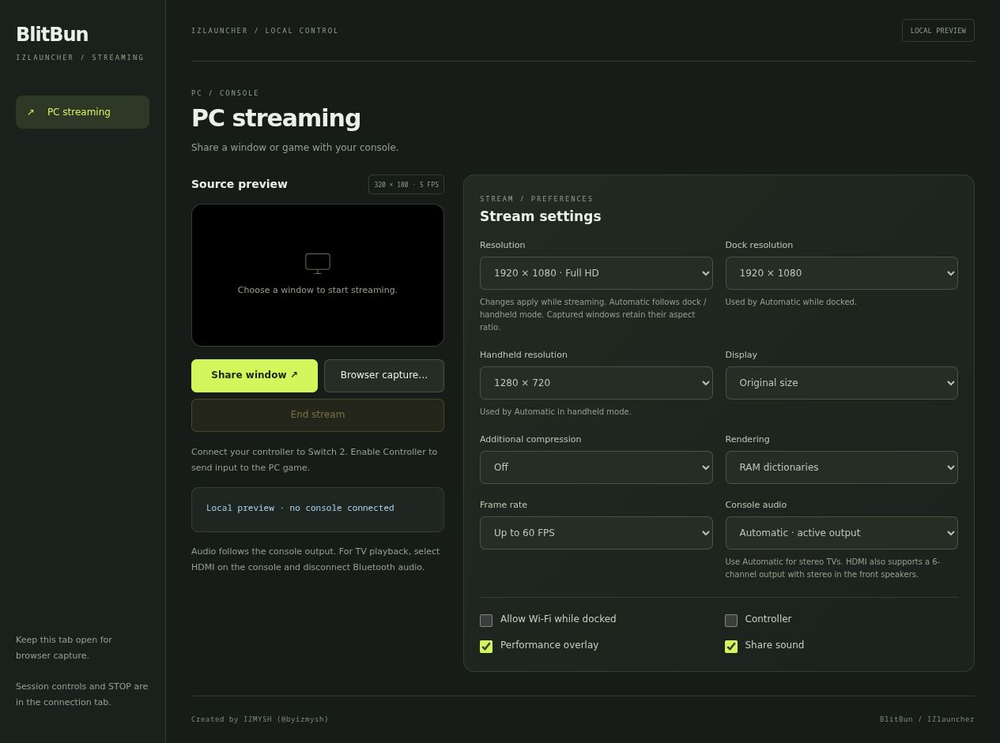
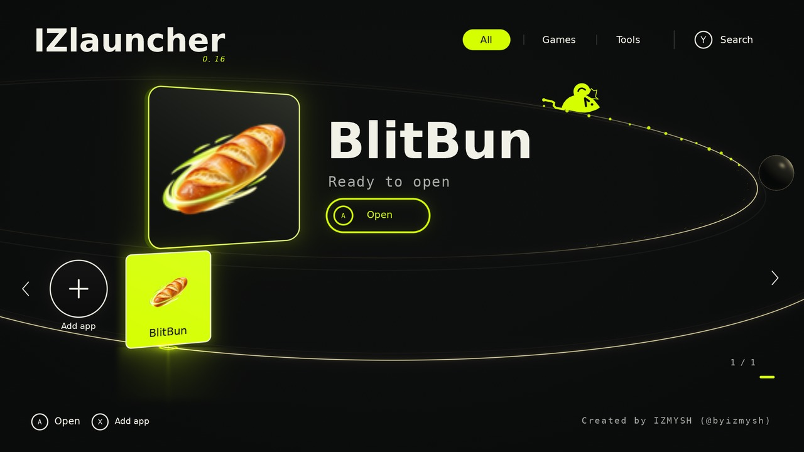
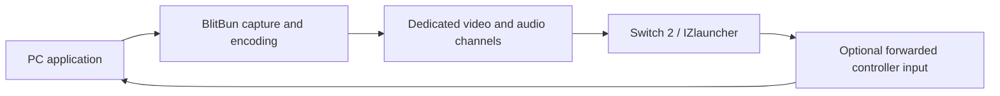

# BlitBun

<p align="center"></p>

**Fresh frames, delivered.**

BlitBun is the PC-to-Switch 2 streaming project for **[IZ2S Platform](https://github.com/byizmysh/IZ2S-Platform)**. It sends a selected application's video and audio to the console and can forward a controller connected natively to Switch back to a PC game. It was previously displayed as `???` / IZlink.

**IZ2S Platform and its IZlauncher shell are required. This repository is a module, not a replacement console engine, standalone Switch exploit or game emulator.**

## A quick look

<table align="center">
  <tr>
    <td align="center" width="50%">
      <a href="docs/images/controls.jpg"></a><br>
      <sub><strong>PC controls</strong><br>Select a source and adjust resolution, compression and rendering. Click for the full panel.</sub>
    </td>
    <td align="center" width="50%">
      <a href="docs/images/izlauncher.jpg"></a><br>
      <sub><strong>Ready in IZlauncher</strong><br>Load the module and open its console tile to start the streaming workflow.</sub>
    </td>
  </tr>
</table>

<p align="center"><sub>Actual local panel preview and console shaders rendered on the host. No console session or measured stream performance is shown.</sub></p>

## Original streaming implementation

BlitBun is an original PC-to-Switch streaming implementation developed for IZ2S Platform. It owns the frame encoding, block/delta packet format, transport scheduling and console-side rendering path. It does not wrap a Moonlight, Sunshine or Steam Remote Play client. Standard building blocks still retain their own origins: BC1 is a standard lossy texture format, DEFLATE is a standard compression format, and capture/runtime libraries are external dependencies.

The implemented pipeline is:

1. Capture a selected X11/XWayland window with FFmpeg or an offscreen XComposite surface; browser capture uses the browser's supported sharing API.
2. Convert fresh frames to BC1 texture blocks, using the WebAssembly/SIMD encoder or optional native acceleration where available. The other declared RGB565/indexed paths remain available for their supported sizes.
3. Compare encoded blocks with the acknowledged reference, omit unchanged regions and package changes for transmission. Optional additional DEFLATE compression trades bandwidth for processing time; stored DEFLATE blocks keep the same encoded image with less compression work.
4. Send bounded packets through a dedicated connection, validate acknowledgements and keep the current frame plus bounded preparation work. The browser control panel is not a video relay. Route/source/resolution changes invalidate old work before a fresh frame can become visible.
5. Reconstruct and render the image through the IZlauncher console contribution, with mapped/buffered paths and RAM-dictionary decoding options. Application audio has its own capture/queue path; controller forwarding is optional and separate.

The custom engineering is in how these pieces are encoded, scheduled, transferred and reconstructed for this console environment. It is not a claim to have invented BC1 or DEFLATE, and it does not guarantee a particular FPS or latency on every machine. See the rendering/compression controls below for the actual tradeoffs.

## What runs where?

The application/game and capture/encoding run on the Linux PC. IZ2S provides the established qualified console session and shared services. BlitBun owns capture, compression, audio, stream listeners and its console contribution. The Switch presents the image/audio and supplies supported input.



Video goes through a dedicated path rather than through the browser panel for another copy. The module opens its own loopback controls tab with OS-assigned listeners when activated, and closes its owned services on exit.

## Requirements

- Linux x64 or ARM64, IZ2S Platform 0.16.0-rc.2 or newer, platform API 1, console ABI 1 and IZlauncher.
- A working console session using the platform's supported engine/bootstrap workflow. Installing this module does not type or replace a bootstrap.
- Python 3, FFmpeg, X11/libX11/libXRes for the direct-window capture path, and a browser with WebGL2 for browser capture.
- PipeWire/PulseAudio compatibility, `pactl` and `parec` for application audio.
- Optional: C compiler, Node N-API development headers, `pkg-config` and libdeflate development files for native acceleration. Software fallbacks remain available where declared.
- Optional **Controllers** module for virtual PC-gamepad forwarding. Video-only sharing works without it. A particular game may declare additional module/runtime dependencies.

ARM64 platform support does not make an x64-only game run on ARM. The experimental standalone GPU-test module is a different package and is not bundled here.

## Install into IZ2S

Install [IZ2S Platform](https://github.com/byizmysh/IZ2S-Platform/releases/latest) first, then download the BlitBun installation archive from [Releases](https://github.com/byizmysh/BlitBun/releases/latest) and extract it. A Git checkout works too. Open a terminal in this folder and set the actual platform directory:

```sh
IZ2S="/absolute/path/to/iz2s-platform"
./install.sh --platform "$IZ2S"
```

For an intentional update, stop the relevant console session first and use:

```sh
./install.sh --platform "$IZ2S" --replace
```

The installer validates the platform/module, installs into `modules/BlitBun/`, and creates its `.izm`. Existing installations require `--replace`; the previous module is moved into the platform's private `data/module-backups/`. Existing module preferences/runtime are preserved. The installer does not start a console session or modify an engine.

The archive contains the module source, console contribution and installer. System capture/audio tools listed above are separate host requirements; `install.sh` installs the module without changing system packages.

The module ID is **`blitbun`**, its installation directory is **`modules/BlitBun/`**, and its package is **`blitbun.izm`**. The installer can migrate the former `pc-screen` module with `--replace`, preserving private settings/runtime and a backup. BlitBun does not require VacooTube.

In IZ2S App library, select/load BlitBun, start a fresh compatible session, then open its tile on Switch. Use the adjacent PC controls tab to choose the source. Installing files and loading/running the console module are separate actions.

Manual installation is also possible: copy this complete module source tree or its generated `blitbun.izm` into the matching platform folder. Keep your old module data separately and repack changed sources. The scripted installer is preferable because it keeps a backup.

The PC panel uses a separate **320 × 180 source preview, refreshed at up to 5 FPS**. Its small size and refresh rate do not change the console stream resolution or frame-rate setting. Source selection and stream status sit beside the settings; there is no Doom launch action in the PC panel. Native-window previews are best-effort thumbnails of available capture frames.

## Capture modes

| Mode | Use it for | Important detail |
| --- | --- | --- |
| **Share window** | X11/XWayland application windows | One module-owned window selector; chosen source must remain open |
| **Browser capture** | Native Wayland windows, whole desktop or browser-supported sources | Browser/OS permission dialog is controlled by the desktop portal |
| **Game integration** | Compatible separately installed game modules | Reuses BlitBun components; game launch/profile logic belongs to the game module |

You can put another window in front of a captured game when the capture and game-input backend support it. Minimized/hidden windows and a game's own pause/mute settings can still affect its output. Background capture does not automatically make every PC game accept background input.

## Resolution and frame rate

The controls offer 640×360, 832×468, 960×540, 1280×720, 1600×900 and 1920×1080. The selected window retains its aspect ratio and can be limited by the source's actual size. A small source window does not become genuine Full HD detail because the output selector says 1920.

**Automatic** keeps independent Dock and Handheld choices: initially Full HD while docked and HD while handheld. Manual output overrides the physical-mode choice. Changes apply during streaming without intentionally asking you to choose the source again; the receiver may briefly rebuild behind a black waiting screen.

30, 40 and 60 FPS are targets/limits, not guaranteed minimum displayed FPS. A game's render size, the captured source size and the stream output size are separate values.

## Rendering and compression

| Setting | Behavior |
| --- | --- |
| **Rendering: Automatic** | Chooses the existing mapped HD or buffered larger-image path |
| **Rendering: Original** | Retains the original mapped decoder for comparison |
| **Rendering: RAM dictionaries** | Uses buffered decoding and RAM dictionaries for BC1 at HD/Full HD |
| **Additional compression: Automatic** | Uses stored DEFLATE blocks on confirmed Ethernet; temporal compression on Wi-Fi/unknown routes |
| **Additional compression: On** | Uses temporal compression, reducing bandwidth at a processing cost |
| **Additional compression: Off** | Uses stored blocks on either route, reducing some processing at a bandwidth cost |

The extra compression choices preserve the encoded BC1 bytes. BC1 itself is lossy: preserving its bytes does not make the original desktop capture lossless. Unchanged-block omission can still operate when additional compression is off. A fully changing Full HD BC1 image at 60 FPS needs roughly 498 Mbit/s before protocol overhead.

The pipeline prioritizes fresh work and bounds queued frames rather than building an ever-growing buffer. No mode guarantees a minimum frame rate on every host/network/game. Compare the same moving source and profile when evaluating a setting.

## Dock / handheld and recovery

Dock state and network type are separate observations. By default, docked streaming waits for Ethernet and handheld waits for Wi-Fi. **Allow Wi-Fi while docked** permits the docked resolution over Wi-Fi. It does not force the console OS to choose an adapter.

A route/resolution/source transition closes the display gate and shows black until a fresh complete validated frame arrives. The local menu remains available where the main session is healthy. Stale uploads and old frame waits are cancelled.

Video can reconnect while the main native session is still valid. The unchanged ordinary bootstrap cannot recreate its ended main connection. If the main session is lost or a native writer cannot safely join, follow IZ2S's fresh-console restart instructions. This module does not install a recovery bootstrap or Wi-Fi driver.

## Audio and controls

Enable **Share sound** to send supported application audio. Capture is scoped to the selected application/owned source; there is no implicit microphone fallback. Choose the console's active output, or the explicit HDMI/Bluetooth profile. A game may separately mute itself on focus loss.

A Pro Controller/Joy-Con stays paired with Switch. Optional forwarding creates a virtual PC device through the Controllers module. A single Minus is forwarded as game Back/Select after its 250 ms classification window; a quick double Minus toggles the stream overlay. Plus belongs to the game. Other modules may define different controls.

## Files, development and releases

| Path | Purpose |
| --- | --- |
| `module.json`, `switch/` | Module descriptor, console contribution and icons |
| `server/` | Capture, encoding, audio, input bridge and shared public components |
| `server/native/` | Optional native accelerator sources/build recipes |
| `assets/` | Icon master and generation/design record |
| `tools/module.cjs`, `install.sh` | Platform-aware check/package/install/release helpers |
| `runtime/`, `data/` | Local compiled dependencies/preferences; ignored by Git |
| `blitbun.izm` | Generated portable module package; ignored by Git |
| `dist/` | Built source release archive and checksums; ignored by Git |

```sh
node tools/module.cjs check --platform "$IZ2S"
node tools/module.cjs pack --platform "$IZ2S"
# Commit finished source changes before building a release:
node tools/module.cjs release --platform "$IZ2S"
```

Keep mutable data and generated binaries out of public Git history. An active session keeps its pinned package until it ends. The module format is ZIP with checksums; only its declared console files are sent to Switch.

Other modules declare `blitbun` as a dependency and consume the inventory in `module.json`, such as `module:blitbun/stream`, `create`, `codec`, `nativeWindow`, `windowFocus` and `frameAvailability`. Do not import another repository by an absolute local path.

[Operations and troubleshooting](docs/OPERATIONS.md) · [Source and license notices](THIRD_PARTY.json) · [License status](LICENSE).

## Window capture recovery (1.14.1)

A transient X11 drawable error now suspends and restarts video capture for the
same verified window and process. The audio recorder stays open. Stale frames
are discarded through the existing freshness handshake before new frames can
be shown. Hidden windows wait for restoration. After three consecutive failed
restarts without a frame, capture reports a terminal error instead of retrying
forever. A new IZlauncher session is required to load this updated module.

## Offscreen window surfaces (1.14.2)

The public native-window capture component accepts `offscreen: true`. This is
enabled by Space Rangers 1.1.0. It holds a named XComposite pixmap for the exact
verified client, instead of asking FFmpeg to read a screen window. Overlapping
windows cannot replace game pixels. A temporary unmap does not kill video.
On remap/resize, the current backing surface is acquired automatically. The
surface survives scaler restarts and stream pauses. This path additionally
requires libXcomposite, libXfixes, libXRes and Python Pillow.

An unmapped game can stop drawing. In that case the retained image stays visible
and the report marks `sourceFrozen`; this does not imply live background gameplay.
The real image resumes when the game draws again. No desktop capture, forced
window activation, virtual display or game restart is used by this capture path.

## Host compatibility

Linux only. Windows/macOS streaming is unsupported. Linux x64 was checked locally; ARM64 is a declared target pending full hardware testing. See [support details](SUPPORT.md).

## Project license

Independently authored IZMYSH code is licensed under **GPL-2.0-or-later**.
See [LICENSE](LICENSE), [COPYRIGHT](COPYRIGHT) and [license scope](LICENSE-SCOPE.md).
Existing component licenses and prior MIT grants remain applicable; this is not
a blanket relicensing of third-party material.
