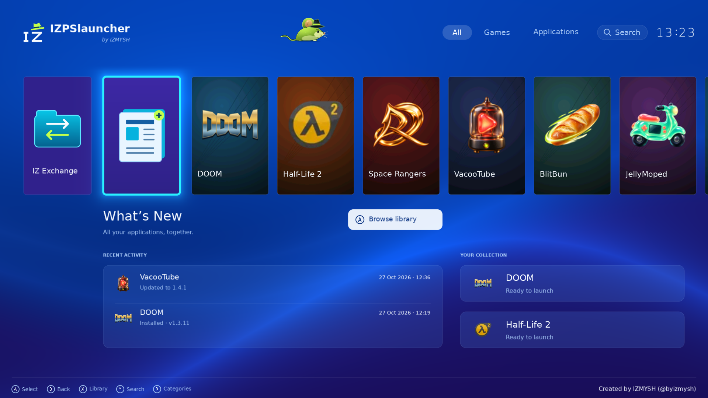
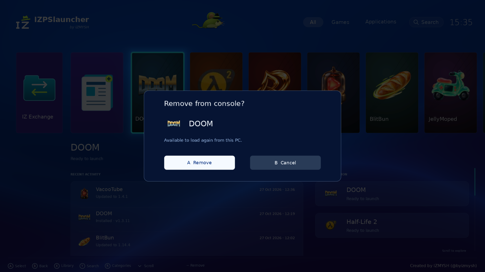

# IZPSlauncher

A native console shell for IZ2S Platform, selectable alongside IZlauncher in **Console connection → Launch mode**. The panel discovers `shell.json` automatically. Select IZPSlauncher before starting a fresh session; a running session keeps its existing shell.

The blue menu includes portrait application cards, cyan focus, categories, search, the shaded lime mouse walking between the title and navigation, and the IZ hat logo with `by IZMYSH`. Recent activity combines module installation, update and removal events with versions and local timestamps. It shows at most six completed operations. Without events the panel shrinks to one row; scrolling follows the actual content height.



## Controls

- Left / Right: select an application. A: open it.
- X: browse the package library. B: return.
- L / R: change category. Y: search.
- Up / Down, the vertical stick or a vertical swipe: scroll when content extends below the screen.
- **Minus** on a loaded application: open **Remove from console**. A confirms; B cancels. The footer action also supports touch.

Removal unloads the session's catalog copy. The PC package remains available to load again. The PC panel provides the same action on loaded application cards. A queued operation waits until the console returns to its menu; it does not stop an active application.



## Build from source

From the repository root, with Node.js 22+, Python 3/Pillow, DejaVu Sans, glslangValidator and spirv-val installed:

```sh
node shells/izpslauncher/build.cjs
node shells/izlauncher/server/build-app.cjs
node distribution/verify.cjs
node --test distribution/tests/*.test.cjs
```

The first command rebuilds the bootstrap shaders, menu typography and all three console shader stages, then validates SPIR-V. Precompiled files are included in the installation archive. [Platform build and installation guide](../../README.md#build-from-source).

`server/ps_fonts.py` resolves fonts on Debian/Ubuntu and Arch. `server/activity.cjs` publishes completed job history to a bounded text mailbox; `app/shaders/ps-layout.glsl` shares layout and scroll limits with the input shader. Removal uses menu-owned ABI-1 scratch words and the existing package queue. No console filesystem uninstall is performed.

Desktop Vulkan rendering and navigation checks passed before packaging. The new shell has not been physically tested on Switch/ARM64. [Host support](../../SUPPORT.md).

## Module compatibility

IZPSlauncher implements the IZlauncher module format on console ABI 1. Its descriptor declares `moduleShells: ["izlauncher"]`, so existing modules remain available under this visual shell. Platform and ABI checks are still required. This corrects the empty library in rc.4.
